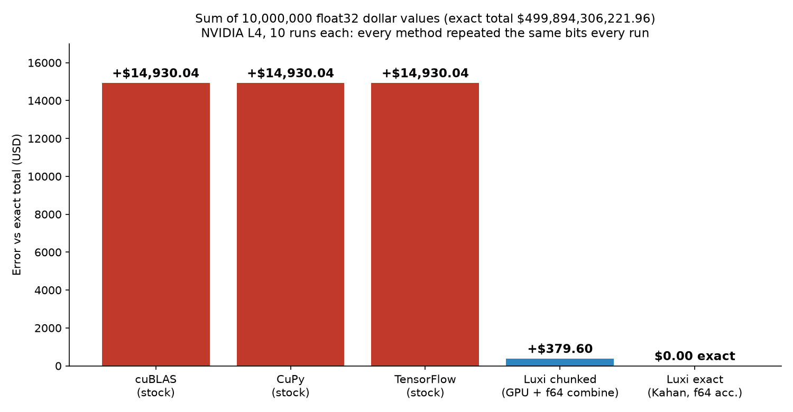
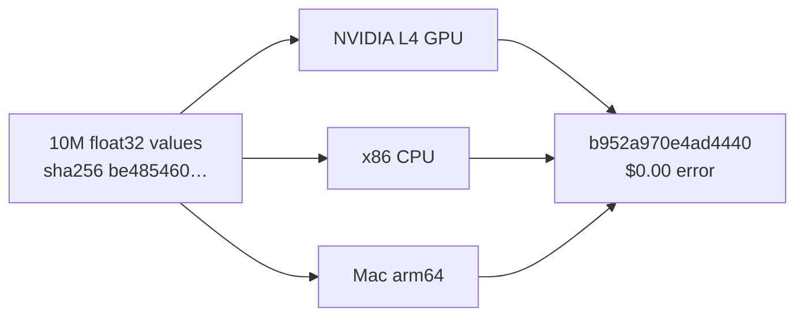

# Stock GPU sums are repeatable, but wrong

**Add up 10,000,000 dollar values in float32 on an NVIDIA GPU. cuBLAS, CuPy and TensorFlow each return the same answer every run, and it is $14,930.04 off.** A repeatability check would pass them. An accuracy check would not.

Luxi's fixed-order Kahan sum returns the **exact total, $0.00 error**, with the **same result hash on an NVIDIA L4 GPU, an x86 CPU and an Apple Silicon Mac (arm64)**.

**Exact total:** `$499,894,306,221.96` (correctly rounded `math.fsum`) · **Test date:** 2026-10-13 · **GPU:** NVIDIA L4 · **10 runs per GPU method**

## Results (float32 input, NVIDIA L4)

| Method | Error vs exact | Median time per sum | Same bits all 10 runs | Result hash |
|---|---:|---:|:---:|---|
| NVIDIA cuBLAS dot with ones (stock) | **+$14,930.04** | 0.62 ms | ✅ | `c50bc247dbde0944` |
| CuPy `sum` (stock) | **+$14,930.04** | 0.05 ms | ✅ | `c50bc247dbde0944` |
| TensorFlow `reduce_sum` on GPU (stock) | **+$14,930.04** | 0.20 ms | ✅ | `c50bc247dbde0944` |
| **Luxi GPU reduce, chunked + float64 combine** (Kahan) | **+$379.60** (39× closer) | **0.05 ms** | ✅ | `9a17a62a95eea0eb` |
| **Luxi GPU reduce, chunked + float64 combine** (fast) | **+$379.60** | **0.03 ms** | ✅ | `c4ee4fac152d0ee1` |
| **Luxi fixed-order Kahan, float64 accumulator** | **$0.00 (exact)** | 1,027 ms on GPU (1 thread)† | ✅ | `b952a970e4ad4440` |

† The exact method is a correctness path, not a speed path, on the GPU. The same method on the x86 CPU returned the identical hash in a 30 ms median.

All three stock libraries land on the **same wrong number**: `499,894,321,152`, the float32 value they round to. Agreeing with each other and with themselves proves repeatability, not correctness.

## Same answer on three machines

| Result | NVIDIA L4 GPU | x86 CPU | Mac arm64 |
|---|---|---|---|
| Exact sum, $0.00 (`b952a970e4ad4440`) | ✅ | ✅ | ✅ |
| Luxi chunked Kahan kernel order (`9a17a62a95eea0eb`) | ✅ GPU kernel | ✅ CPU replay of kernel order | ✅ CPU replay of kernel order |
| Luxi single-tensor Kahan kernel order (`dea3ba0d0d333c55`) | ✅ GPU kernel | ✅ CPU replay of kernel order | ✅ CPU replay of kernel order |
| Input data SHA-256 `be485460c3f3f047…` | ✅ | ✅ | ✅ |

Because the Luxi reduction pins its order of operations, its result is a property of the data, not of the hardware it ran on. The cross-machine claim applies only to the three hashes above; nothing else is claimed.

## What this does and doesn't show

- **Accuracy, plus a hash anyone can reproduce on other hardware.** Stock GPU sums were also repeatable on this test, so this is not a run-to-run noise result.
- **"Chunked" means** 1,000 blocks of 10,000 values. Each block is reduced on the GPU by the Luxi kernel, and the 1,000 block totals are combined in fixed order in float64 on the host. Part of the +$379.60 gain comes from that float64 combine.
- **As a single 10M-value tensor, the Luxi GPU kernels were less accurate than stock:** Kahan +$29,715.54, fast −$48,409.46. The chunked layout is the one to use.
- **In float64, stock cuBLAS, CuPy and TensorFlow were exact** on this data. The gap is a float32 effect.
- **Synthetic data** (uniform random positive values), not a customer portfolio. **One GPU model** (NVIDIA L4).
- **Energy:** not reported. The power log samples every 100 ms and these sums take 0.03 to 0.6 ms, so energy per sum can't be separated honestly from it.

## Verify it yourself

Closed engine, open evidence. The Luxi kernel source is not published.

1. Download `data_f32.bin` (40 MB) from the [release `gpu-sum-2026-10-13`](https://github.com/RegularJoe-CEO/LuxiDemo/releases/tag/gpu-sum-2026-10-13).
2. Run `bash verify.sh data_f32.bin` (needs `python3` and `numpy`). It checks the input hash, computes the exact total, and checks the `b952a970e4ad4440` hash.

Files here: [`results.jsonl`](results.jsonl) (every run, raw), [`summary.txt`](summary.txt), [`power.csv`](power.csv) (raw GPU power log), [`verify.sh`](verify.sh).

*LuxiEdge · e@ewaller.com*
