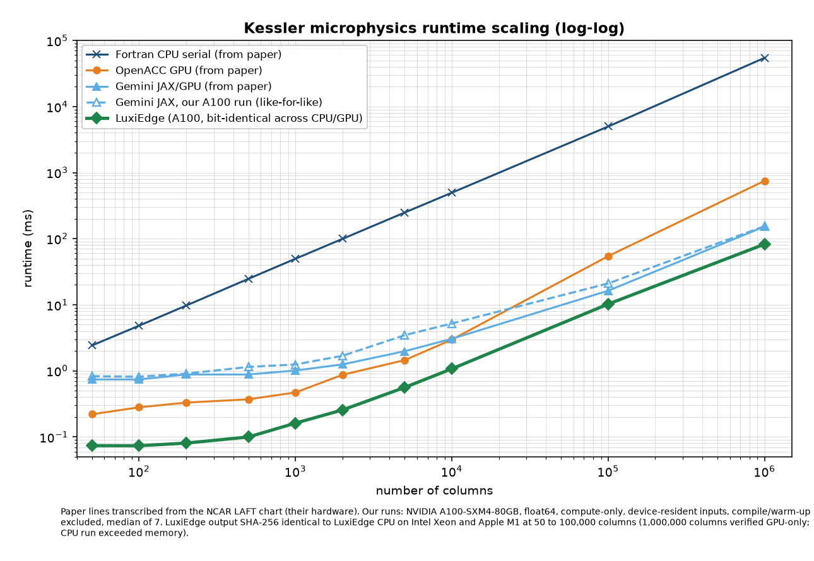

# Kessler microphysics determinism across chips: NCAR LAFT JAX translations vs Luxi

**Question:** given identical float64 inputs, does each implementation of the Kessler warm-rain scheme return bit-identical output on different chips, and what does that cost in speed?

*Chart: the Fortran CPU serial, OpenACC GPU and Gemini JAX/GPU "from paper" lines are transcribed from the scalability figure of Linck, Dennis, Schreck, Stengel and Gagne (2026), measured by the NCAR authors on their hardware. The dashed JAX line and the LuxiEdge line are our runs.*

## Citation and credit
The LAFT framework, the four LLM translations, the Fortran Kessler reference and the paper chart lines are the work of the NSF NCAR authors below, used under their Apache License 2.0. This page only reruns their published code and data.

**Paper (preprint):**
> Linck, I., Dennis, J., Schreck, J., Stengel, K., & Gagne, D. J. (2026). Evaluating LLMs for Translating Legacy Fortran Atmospheric Physics to GPU-Accelerated JAX. Preprint submitted to arXiv; manuscript submitted to the Journal of Advances in Modeling Earth Systems (JAMES). Code and data: https://doi.org/10.5281/zenodo.22696825

**Software:**
> Linck, I., Dennis, J., Schreck, J., Stengel, K., & Gagne, D. J. (2026). LAFT: LLM-Assisted Fortran Translation (Version 1.0.0) [Software]. NSF National Center for Atmospheric Research. https://github.com/NCAR/LAFT, commit `ae95165`. https://doi.org/10.5281/zenodo.22696825. License: Apache-2.0.

**Original scheme** (cited in the LAFT Fortran reference, which implements Kessler (1969) as described by Soong and Ogura (1973) and Klemp and Wilhelmson (1978)):
> Kessler, E. (1969). On the Distribution and Continuity of Water Substance in Atmospheric Circulations. Meteorological Monographs, vol. 10, no. 32. American Meteorological Society. https://doi.org/10.1007/978-1-935704-36-2_1

> Klemp, J. B., & Wilhelmson, R. B. (1978). The Simulation of Three-Dimensional Convective Storm Dynamics. Journal of the Atmospheric Sciences, 35, 1070-1096.

Citation text is taken from the LAFT README and CITATION.cff at commit `ae95165`. The arXiv identifier and journal DOI were not yet assigned there. No affiliation with or endorsement by NCAR or the authors is implied.

## Setup
- Source: [NCAR LAFT](https://github.com/NCAR/LAFT) at commit `ae95165`. LAFT translates the Fortran Kessler scheme to JAX with LLMs; four public translations were tested (Claude Sonnet 4.6, Gemini 3.1 Pro, GPT-5.4 Thinking, Qwen 2.5 32B), plus the Fortran reference.
- Inputs: LAFT-generated columns, 56 levels, float64. The same input files were used on each of the three tested chips (input hashes checked per platform). For the timing sizes, the 4,096-column input was tiled cyclically to each column count.
- Output: theta, qv, qc, qr, precl, relhum as float64, compared bit-for-bit by SHA-256 (first 16 hex shown).
- Chips: Intel Xeon (Linux x86_64), Apple M1 Pro (macOS arm64), NVIDIA A100 80GB.
- Luxi: closed float64 Kessler port on the Luxi engine.
- Every implementation was repeatable run-to-run on the same chip.

## 1. Cross-chip identity, 4,096 columns
| Implementation | Intel Xeon | Apple M1 Pro | NVIDIA A100 | One hash on all chips? |
|---|---|---|---|---|
| Claude Sonnet 4.6 JAX | `fe6c9efd7cd3e0c2` | `0e010c0ad441c34c` | `93408b8ddd638db5` | no |
| Gemini 3.1 Pro JAX | `5ef07f9608f2bd72` | `0ebc7844054aaa95` | `b08a1d7132c90e1f` | no |
| GPT-5.4 Thinking JAX | `5ef07f9608f2bd72` | `0ebc7844054aaa95` | `b08a1d7132c90e1f` | no |
| Qwen 2.5 32B JAX | `7ec3f5dad01e29ee` | `7387e296d954fa2f` | `b08a1d7132c90e1f` | no |
| Fortran reference (Xeon) | `404717789fb3823f` | | | |
| **Luxi** | `f2b13997f5d87583` | see table 2 | `f2b13997f5d87583` | **yes** |

Every JAX output stays within rounding of the Fortran (largest absolute differences of order 1e-13 in theta and 1e-16 or smaller in the mixing ratios). The finding is non-reproducibility across hardware, not inaccuracy.

## 2. Cross-chip identity at the timing sizes
| Columns | Luxi Xeon | Luxi M1 Pro | Luxi A100 | Gemini JAX Xeon | Gemini JAX M1 Pro |
|---|---|---|---|---|---|
| 50 | `bc1624a105d7ed40` | same | same | `f3e1c7ce5e69864a` | `b2ba6a8a3cd31c03` |
| 100 | `bec9019c555bf80a` | same | same | `5f8af84b9c9b1c91` | `d5e85217cd8152ab` |
| 200 | `e9e4c151936f511e` | same | same | `a4554d1776ba7968` | `62523312e70c40fe` |
| 500 | `51f6834a01999eb5` | same | same | `7e79d7188a765649` | `3d022ab27fc89e77` |
| 1,000 | `40aea38e4682ed27` | same | same | `406f612f3370b690` | `b28af396daa75cdd` |
| 2,000 | `92e2ad102c45ae9a` | same | same | `c38e52deec02c983` | `274b24d7b752f5c4` |
| 5,000 | `54fb5d3d16aaa9af` | same | same | `ec8956853681c6ff` | `2a36c6258ab37fe1` |
| 10,000 | `d665e48a0127812a` | same | same | `cfd288e18764e77a` | `f968de4eac0d367f` |
| 100,000 | `23f74685197af5e2` | same | same | `58c833ee9c711ba5` | `cfa71809bcd90eb3` |
| 1,000,000 | not run (memory) | not run (memory) | `6786c2786dc328a9` | not run | not run |

## 3. Speed on NVIDIA A100 (same pod, median ms per call)
| Columns | Luxi | Gemini JAX | JAX / Luxi |
|---|---|---|---|
| 50 | 0.074 | 0.83 | 11.3x |
| 100 | 0.073 | 0.81 | 11.1x |
| 200 | 0.080 | 0.91 | 11.3x |
| 500 | 0.100 | 1.14 | 11.5x |
| 1,000 | 0.161 | 1.25 | 7.7x |
| 2,000 | 0.256 | 1.69 | 6.6x |
| 5,000 | 0.560 | 3.46 | 6.2x |
| 10,000 | 1.072 | 5.20 | 4.9x |
| 100,000 | 10.23 | 21.02 | 2.1x |
| 1,000,000 | 82.52 | 154.56 | 1.9x |

GPU: NVIDIA A100-SXM4-80GB, CUDA 12.4.

## 4. CPU: hash evidence, plus Luxi 8-thread vs Fortran serial
The CPU runs above are published as hash evidence (table 2). No CPU speed comparison against JAX is shown, because the JAX CPU runs did not record a matched thread count.

Separate line, Intel Xeon box (8 cores), median ms per call: **Luxi 8 threads** vs **NCAR Fortran reference, gfortran, serial**. Not a JAX comparison.
| Columns | Luxi, 8 threads | Fortran, serial | Fortran / Luxi |
|---|---|---|---|
| 50 | 1.26 | 1.89 | 1.5x |
| 100 | 1.88 | 4.42 | 2.4x |
| 200 | 4.42 | 8.49 | 1.9x |
| 500 | 6.34 | 21.71 | 3.4x |
| 1,000 | 13.53 | 49.96 | 3.7x |
| 2,000 | 32.31 | 107.83 | 3.3x |
| 5,000 | 75.01 | 322.65 | 4.3x |
| 10,000 | 145.75 | 758.81 | 5.2x |
| 100,000 | 1,396.9 | 8,437.8 | 6.0x |

Luxi 8-thread hashes match the Luxi 1-thread hashes at every size. Fortran is single-threaded by design, so this row shows what the Luxi engine delivers on the same CPU, not a thread-matched race.

## Method
- Both GPU implementations were timed the same way: inputs and outputs resident on the device, one call per timed iteration, compile and warm-up excluded, median of 7.
- Luxi GPU time is GPU event time around a single launch. Gemini JAX time is the compiled `kessler_run_core` called directly with `block_until_ready`. Both ran on the same pod in the same session.
- CPU: in-process kernel time, file parsing excluded, 1 warm-up, median of 7 (3 at 100,000 columns). Fortran timed with a Fortran driver using the same median rule.
- Paper series (Fortran CPU serial, OpenACC GPU, Gemini JAX/GPU) are transcribed from NCAR's published chart and were measured on NCAR's hardware with NCAR's harness. They are shown for context only. Our same-pod JAX run is the like-for-like comparison.

## Caveats
- 1,000,000 columns is verified on GPU only. The CPU runs exceeded available memory at that size, so the 1M Luxi hash is checked across GPU runs, not against Luxi CPU.
- The 4,096-column Luxi hash in table 1 is recorded for Xeon and A100. M1 Pro identity for Luxi is shown at the nine timing sizes in table 2.
- The paper OpenACC timing uses whole-process wall clock, a different method from ours. Treat paper lines as indicative.
- Timing sizes use tiled inputs, not freshly generated columns per size.
- No affiliation with or endorsement by NCAR is implied. The LAFT translations are used as published.

## Closed engine, open evidence
Inputs are the public LAFT inputs and the hashes above are published so anyone can rerun the JAX translations and check them. The Luxi engine is proprietary and its code is not published. To verify Luxi outputs on your own hardware, contact LuxiEdge.
